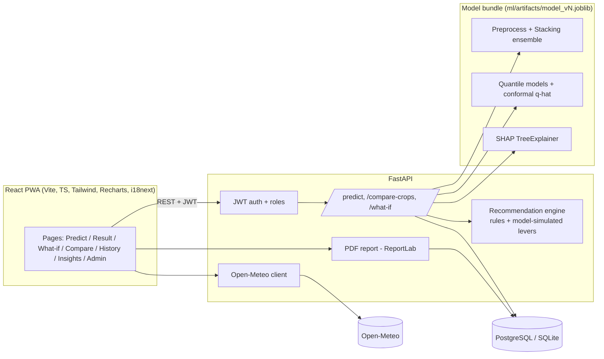
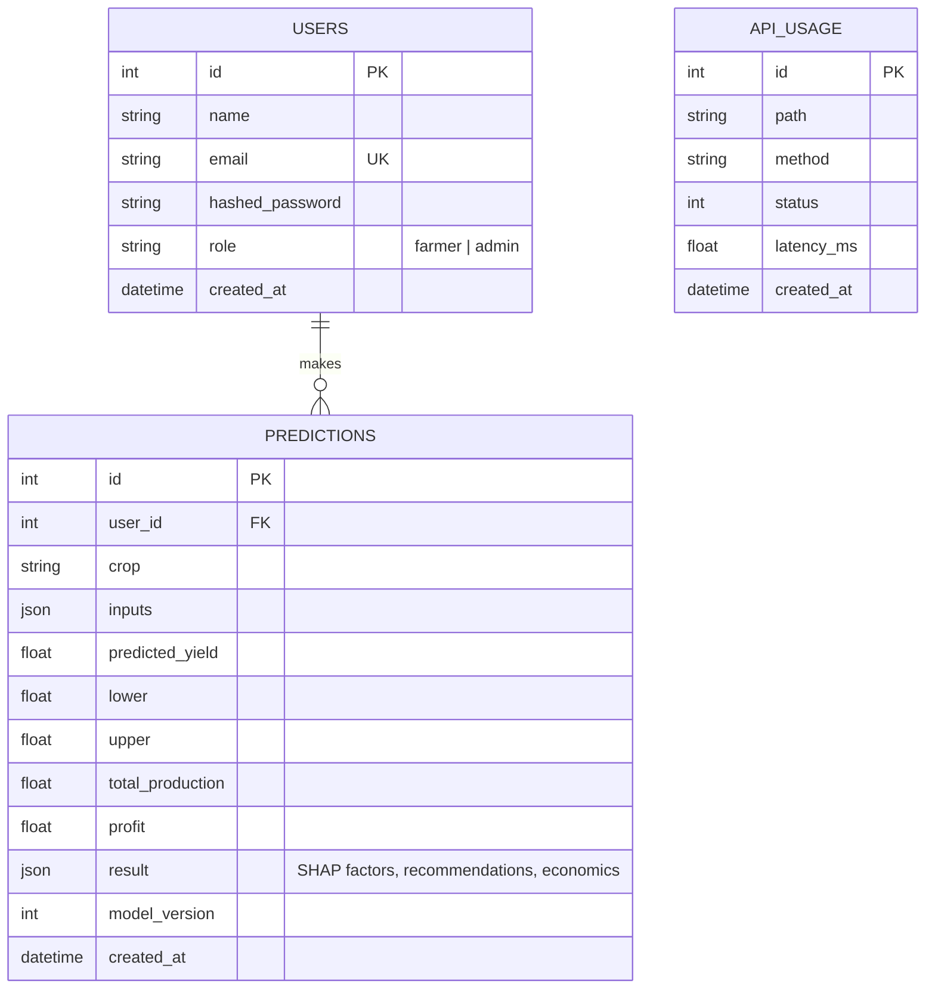
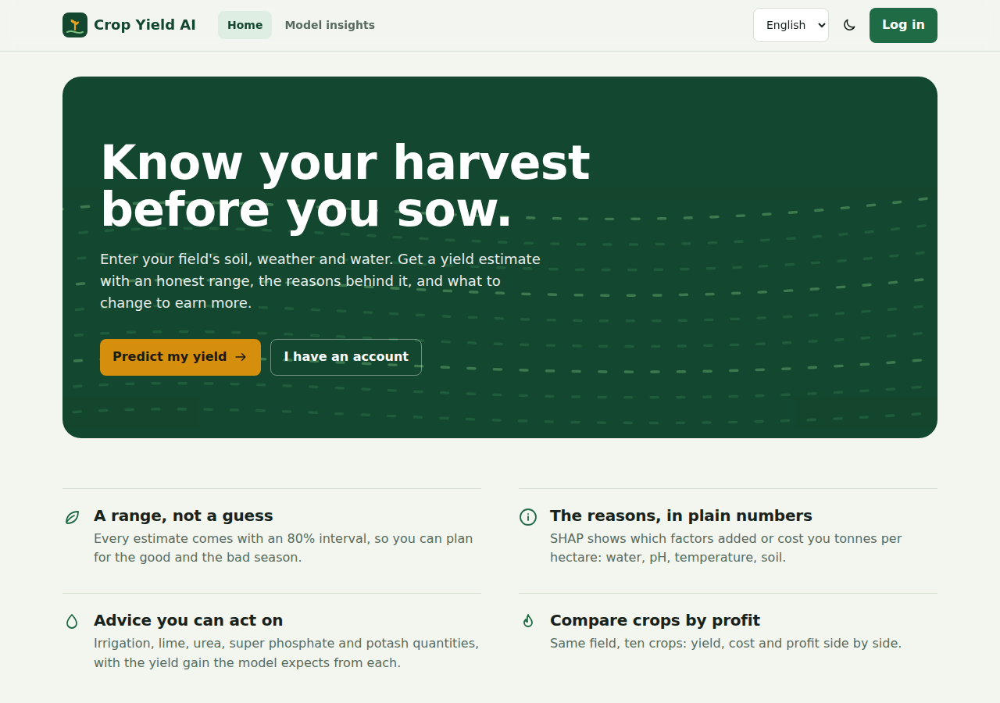
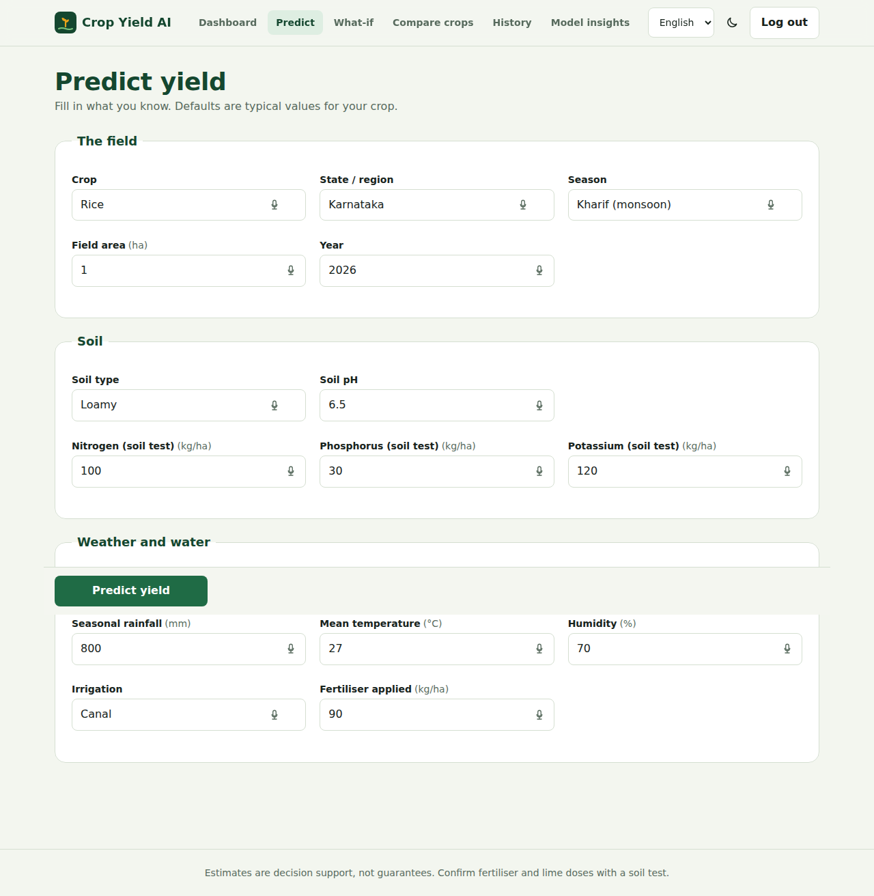
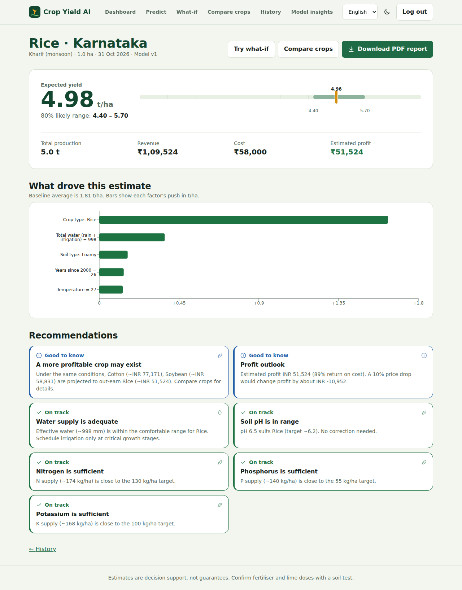
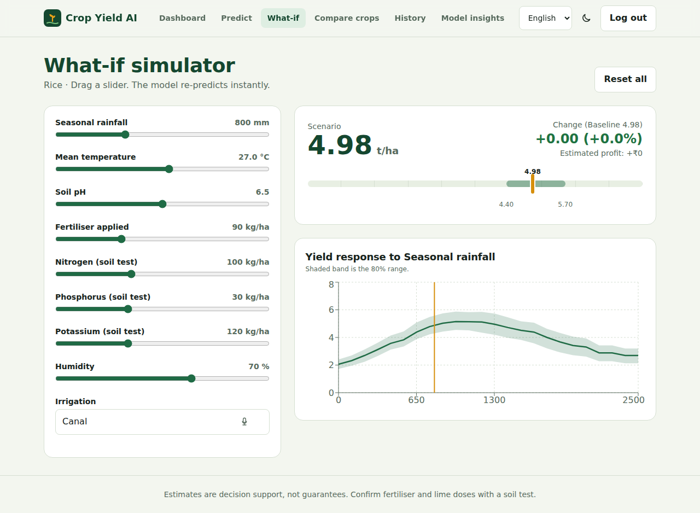
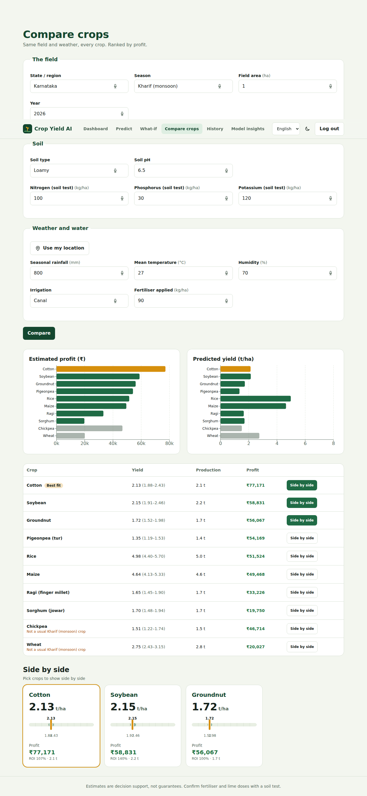
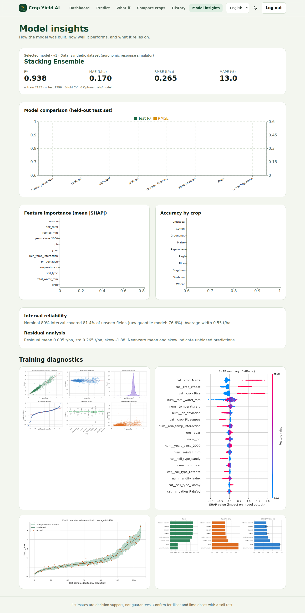
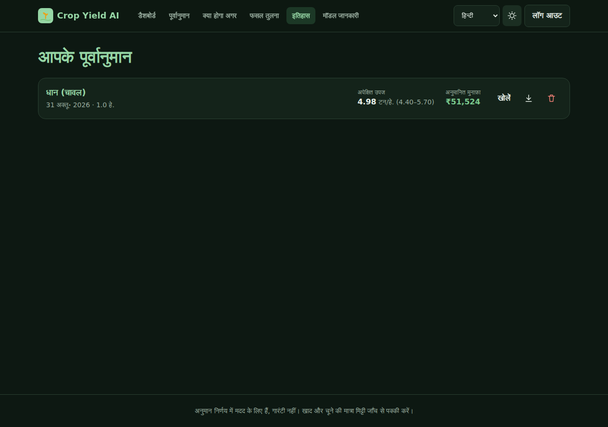
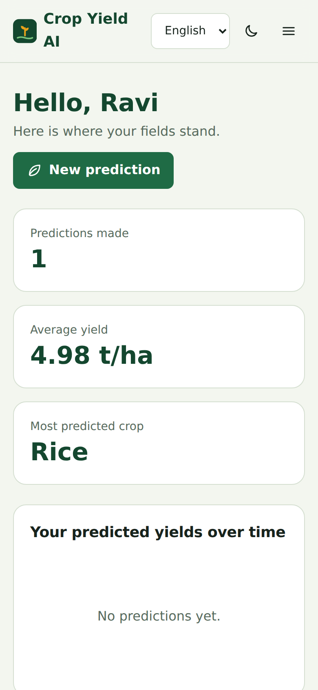

# Crop Yield AI: Prediction and Intelligent Decision Support

An end-to-end system that predicts crop yield from crop, soil, weather, irrigation and area, then **explains** the prediction (SHAP), **quantifies uncertainty** (80% prediction interval), and gives **actionable advice** (irrigation, lime, N/P/K, crop choice, profit). English, Hindi and Kannada UI, voice input, dark mode, installable PWA.

> **Data note.** The shipped model (`model_v1`) uses a **synthetic dataset** generated by an agronomic response simulator (`ml/src/data_gen.py`). Results therefore show the *pipeline works*, not real-world accuracy. For real data use the district-level pipeline below. See [docs/limitations.md](docs/limitations.md).

## Headline results (held-out test set, 1,796 fields)

| Metric | Stacking ensemble (selected) |
|---|---|
| R² | **0.938** |
| MAE | 0.170 t/ha |
| RMSE | 0.265 t/ha |
| MAPE | 13.0 % |
| 80% interval empirical coverage | **81.4 %** (mean width 0.55 t/ha) |

Full comparison of 8 models, per-crop accuracy and discussion: [docs/results.md](docs/results.md).

## Architecture



More: [architecture](docs/architecture.md) · [data flow](docs/data-flow.md) · [methodology](docs/methodology.md) · [limitations and future scope](docs/limitations.md) · [viva cheat sheet](docs/viva.md)

## ER diagram



## Satellite crop health (Sentinel-2 NDVI)

Farmers mark a field (point + radius, drawn boundary, or typed coordinates) and get a red/yellow/green **NDVI map** from Sentinel-2 imagery via Google Earth Engine,
the latest observation with a cautious explanation, and the NDVI history. NDVI is a greenness indicator, not a diagnosis. If no cloud-free image exists the page says
so and estimates nothing. Setup (Earth Engine project, credentials), API, limitations and troubleshooting: **[docs/crop-health.md](docs/crop-health.md)**.

```bash
# .env: GEE_PROJECT=your-project-id   (+ `earthengine authenticate` locally, or a service-account key on a server; never commit keys)
pip install -r requirements.txt
python -m backend.app.gee_smoke --lat 14.28 --lon 74.44 --days 60   # one-time check of your Earth Engine setup
uvicorn backend.app.main:app --reload                              # then open the "Crop health" page
```

## Real district-level data (optional second pipeline)

The default model is the **synthetic prototype**. A separate pipeline trains on **real Indian district yield statistics (APY)** merged with
district-level weather (NASA POWER / Open-Meteo) and soil (SoilGrids), evaluated **chronologically** against no-weather baselines, versioned as
`real_district_vN`, and served with `MODEL_VERSION=real_district_v1`. The UI and API label every prediction as *observed*, *regional estimate* or *simulated*.
No real data or real model is shipped: you build it with your own downloads. Full steps, sources, rules and limitations: **[docs/real-data.md](docs/real-data.md)**.

```bash
python -m ml.src.data_download apy --src apy.csv && python -m ml.src.data_download centroids && python -m ml.src.data_download weather && python -m ml.src.data_download soil
python -m ml.src.build_real_dataset && python -m ml.src.train --data real --trials 30
```

## Repository layout

```
ml/         data generator, EDA, features, training, uncertainty, SHAP helpers, artifacts, reports
backend/    FastAPI app (api/, core/, models/, services/)
frontend/   React + Vite + TypeScript + Tailwind PWA
data/       dataset (synthetic CSV generated on first run)
docs/       architecture, data flow, methodology, results, limitations, viva, screenshots
tests/      pytest suite (48 tests)
.github/    CI workflow
```

## Quick start (local)

```bash
# 1. Python env
python -m venv .venv && source .venv/bin/activate
pip install -r requirements.txt
cp .env.example .env

# 2. ML pipeline (a trained model_v1 is already included; retrain for your own numbers)
python -m ml.src.eda
python -m ml.src.train --trials 30 --folds 5      # resumable: re-run if interrupted
mlflow ui --backend-store-uri sqlite:///ml/mlflow.db   # inspect every run

# 3. API  -> http://localhost:8000/docs
uvicorn backend.app.main:app --reload

# 4. Frontend -> http://localhost:5173  (proxies /api to :8000)
cd frontend && npm install && npm run dev
```

Seeded admin: `admin@cropai.app` / `Admin@12345` (**change via `.env` before deploying**). Register any other account from the UI; those are `farmer`s.

## Docker (PostgreSQL + API + nginx-served frontend)

```bash
cp .env.example .env     # set SECRET_KEY and ADMIN_PASSWORD
docker compose up --build
# app: http://localhost:3000    API docs: http://localhost:8000/docs
```

## Tests and lint

```bash
python -m pytest -q          # 237 tests; builds a tiny model automatically, no training needed
ruff check .
cd frontend && npm run lint && npm run typecheck && npm run build
```

## API reference

Interactive docs at `/docs`. All JSON. Auth = `Authorization: Bearer <token>`.

| Method & path | Auth | Purpose |
|---|---|---|
| `POST /auth/register` | – | Create farmer account, returns JWT |
| `POST /auth/login` | – | Returns JWT + user |
| `GET /auth/me` | user | Current user |
| `POST /predict` | user | Yield, total production, 80% interval, top-5 SHAP factors, recommendations, economics. Saved to history |
| `POST /compare-crops` | user | Same conditions for several crops: yield, interval, revenue, cost, profit, ROI, season suitability |
| `POST /what-if` | user | Re-predict with `changes`; optional `sweep` returns a yield response curve for one parameter |
| `GET /weather?lat=&lon=` | – | Live weather (Open-Meteo) to auto-fill temperature, humidity, rainfall |
| `POST/GET/DELETE /crop-health/fields` | user | Save, list, delete a field (GeoJSON polygon or point + radius) |
| `GET /crop-health/fields/{id}/latest`, `/history` | owner | Latest Sentinel-2 NDVI result with map layer; NDVI history |
| `GET /crop-health/status` | – | Is satellite monitoring configured? thresholds, limits |
| `GET /geocode/reverse?lat=&lon=` | – | Exact place name for a map point (OpenStreetMap Nominatim, cached) |
| `GET /geocode/search?q=` | – | Search a place by name (India) |
| `GET /history`, `GET /history/{id}` | user | Your predictions |
| `DELETE /history/{id}` | owner | Delete |
| `GET /report/{id}` | owner | PDF report |
| `GET /crops` | – | Crops, seasons, soils, irrigation, regions, indicative prices |
| `GET /model-info` | – | Version, metrics, model comparison, importance, uncertainty |
| `GET /model-plots/{name}` | – | Training diagnostic images (whitelisted) |
| `GET /admin/stats`, `/admin/users`, `/admin/model-metrics` | admin | Usage statistics and model metrics |
| `GET /health` | – | Liveness + model version |

Example:

```bash
curl -X POST localhost:8000/predict -H "Authorization: Bearer $TOKEN" -H "Content-Type: application/json" -d '{
  "crop":"Rice","region":"Karnataka","season":"Kharif","soil_type":"Red","irrigation":"Canal",
  "ph":6.2,"nitrogen":100,"phosphorus":28,"potassium":120,"rainfall_mm":950,"temperature_c":27,
  "humidity_pct":72,"area_ha":2,"fertilizer_kg_ha":90,"year":2026}'
```

Validation errors return `422 {"detail":"Validation failed","errors":[{"field","message"}]}`. Rate limits are configurable in `.env`.

## Screenshots

| Home | Predict |
|---|---|
|  |  |
| **Result** (range ruler, SHAP, advice) | **What-if** (live response curve) |
|  |  |
| **Compare crops** | **Model insights** |
|  |  |
| **Hindi + dark mode** | **Mobile** |
|  |  |

Training diagnostics (EDA, SHAP, residuals) are in `ml/reports/`.

## Security notes

bcrypt password hashing · JWT with expiry · role checks on admin routes · per-user ownership checks on history/report · strict Pydantic validation · whitelisted static plot names · rate limiting · CORS allow-list · non-root container. Change `SECRET_KEY` and the seeded admin password in any real deployment.