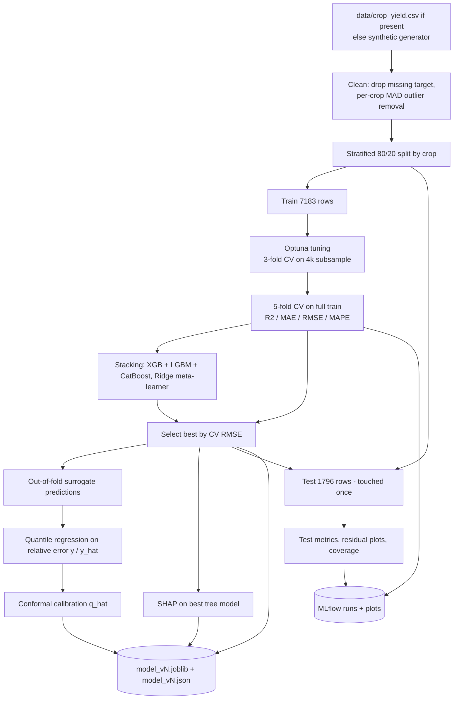
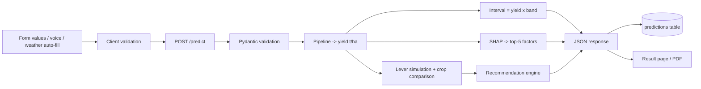

# Data flow

## Training-time

Inside every pipeline: `FeatureEngineer` (per-crop median imputation → IQR winsorising → 13 engineered features) → `ColumnTransformer` (StandardScaler for numerics, one-hot for categoricals) → estimator.

## Inference-time

## Weather auto-fill

Browser geolocation → `GET /weather?lat&lon` → Open-Meteo (90 past days + 7 forecast days) → mean temperature, mean humidity, **90-day rainfall total** → pre-fills the form. Responses are cached 30 minutes per ~1 km cell. The 90-day total approximates, but is not equal to, seasonal rainfall, so the UI says the user should adjust.
