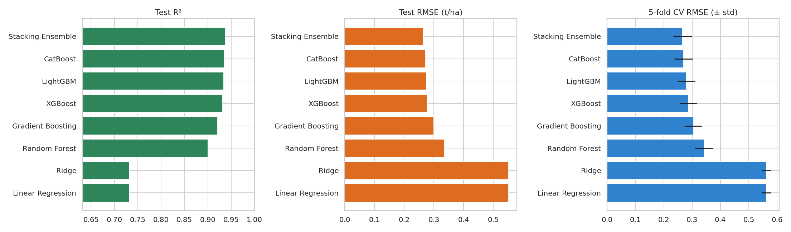
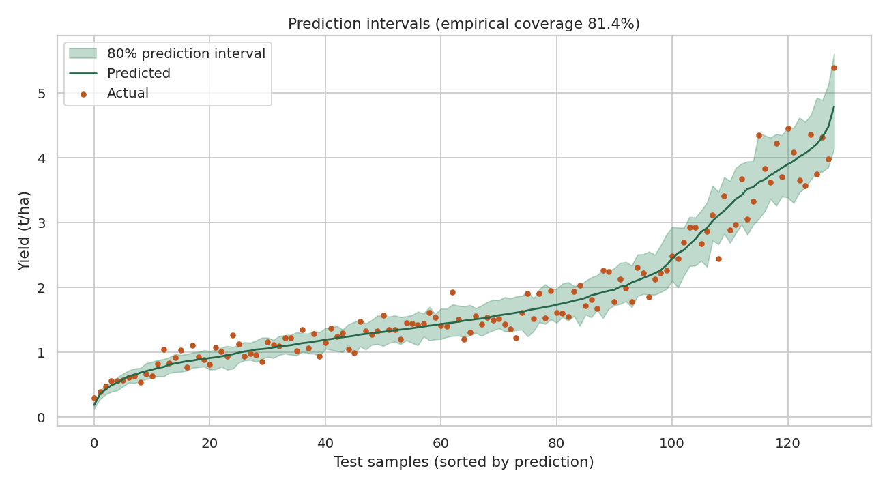
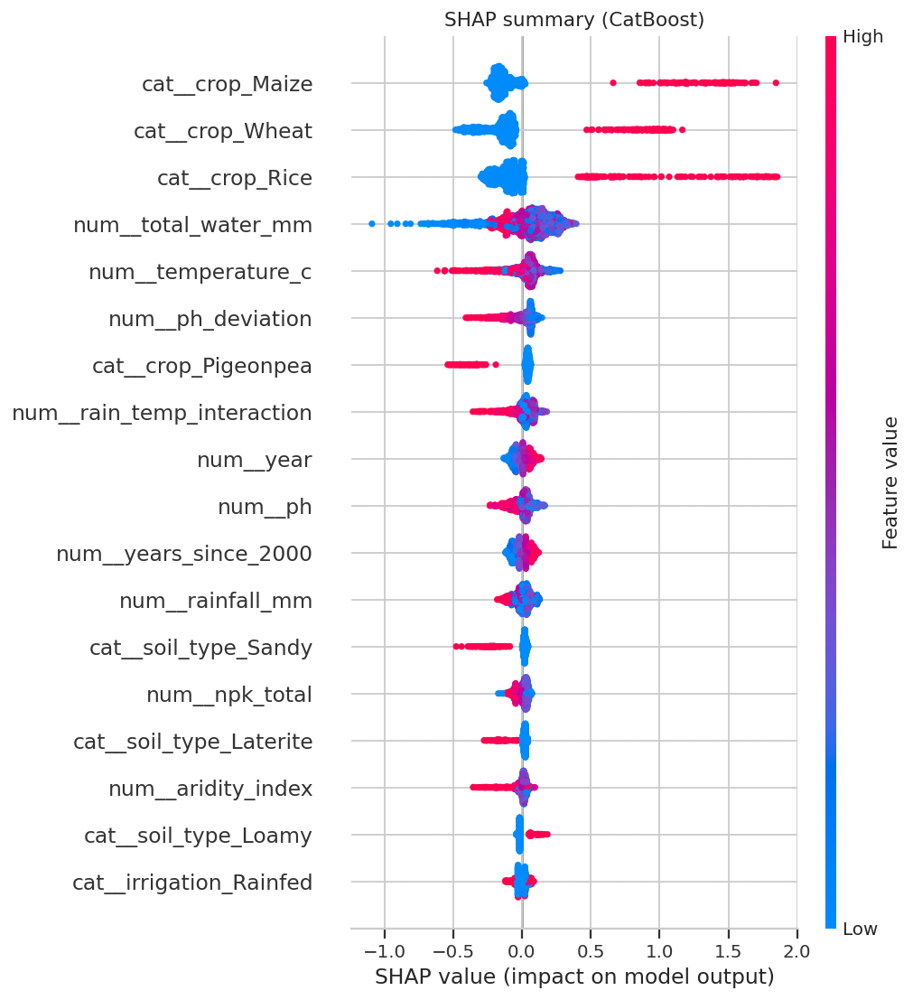
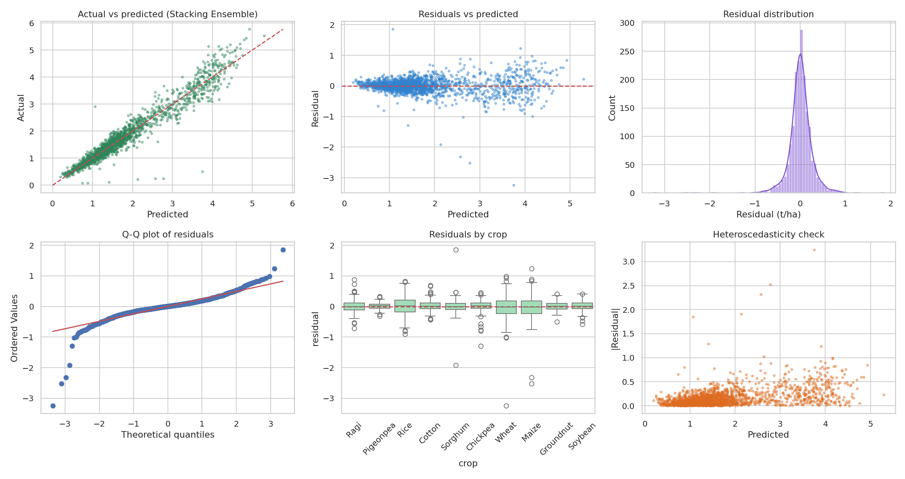

# Results and discussion

All numbers are read from `ml/artifacts/model_v1.json` (trained 2026-10-31, 7183 train / 1796 test rows, 5-fold CV, 6 Optuna trials per model). **Data are synthetic**, so treat these as evidence that the pipeline is correct and comparable across models, not as agronomic accuracy claims.

## Model comparison

| Model | CV RMSE (±std) | Test R² | Test MAE | Test RMSE | Test MAPE % |
|---|---|---|---|---|---|
| **Stacking Ensemble** | 0.266 ± 0.033 | 0.938 | 0.170 | 0.265 | 13.0 |
| CatBoost | 0.270 ± 0.032 | 0.935 | 0.175 | 0.272 | 13.4 |
| LightGBM | 0.279 ± 0.032 | 0.934 | 0.180 | 0.274 | 13.8 |
| XGBoost | 0.286 ± 0.030 | 0.932 | 0.187 | 0.278 | 14.2 |
| Gradient Boosting | 0.305 ± 0.030 | 0.921 | 0.202 | 0.300 | 15.5 |
| Random Forest | 0.342 ± 0.031 | 0.900 | 0.234 | 0.336 | 17.5 |
| Linear Regression | 0.562 ± 0.017 | 0.732 | 0.403 | 0.552 | 29.0 |
| Ridge | 0.562 ± 0.017 | 0.732 | 0.403 | 0.552 | 29.0 |

**Reading the table**
- Linear/Ridge plateau at R² 0.73: the response surface is non-linear (optimum curves, saturation, interactions), and Ridge's regularisation changes nothing because the problem is bias, not variance.
- Boosting beats Random Forest by a clear margin (RMSE 0.27-0.28 vs 0.34), consistent with additive-ish structure with interactions that sequential error-correction captures well on 7k rows.
- CatBoost, LightGBM and XGBoost are within about one CV standard deviation of each other (0.270-0.286 vs std ≈ 0.03). **The stacking gain (0.266 vs 0.270) is smaller than the fold-to-fold noise**, so it was selected because the rule says lowest CV RMSE, not because it is proven better. A simpler single CatBoost would be a defensible production choice.
- MAPE is inflated by low-yield rows (small denominators); prefer MAE/RMSE for decisions.

## Accuracy by crop (selected model, test set)

| Crop | R² | MAE (t/ha) | MAPE % |
|---|---|---|---|
| Rice | 0.913 | 0.247 | 9.3 |
| Soybean | 0.904 | 0.124 | 8.3 |
| Groundnut | 0.886 | 0.105 | 9.8 |
| Ragi | 0.863 | 0.145 | 10.3 |
| Cotton | 0.856 | 0.129 | 8.3 |
| Maize | 0.836 | 0.294 | 19.5 |
| Pigeonpea | 0.816 | 0.086 | 9.7 |
| Wheat | 0.809 | 0.280 | 11.9 |
| Chickpea | 0.667 | 0.131 | 26.5 |
| Sorghum | 0.651 | 0.147 | 15.4 |

Chickpea and Sorghum are the weak spots (R² ≈ 0.65). Both have low absolute yields, so the same multiplicative noise and the same sparse coverage of optimum conditions cause relatively larger errors. Maize has the second-highest MAPE (19.5 %) despite a decent R²; a few low-yield rows dominate. Per-crop models or crop-specific tuning would be the next step.

## Uncertainty

| | Value |
|---|---|
| Nominal coverage | 80% |
| Raw quantile-regression coverage | 76.6% |
| After conformal calibration | **81.4%** |
| Mean interval width | 0.55 t/ha |

The conformal step corrects the under-coverage of the raw quantile model. Coverage is *marginal* (averaged over fields); it is not guaranteed for each crop separately.

## Explainability

Top global drivers by mean |SHAP| (t/ha, explainer = CatBoost):

1. `crop` (0.673)
2. `total_water_mm` (0.159)
3. `soil_type` (0.101)
4. `temperature_c` (0.090)
5. `ph_deviation` (0.080)
6. `rain_temp_interaction` (0.054)
7. `year` (0.053)
8. `ph` (0.050)

Crop identity dominates because crops differ in potential by more than any weather effect. Water, soil type, temperature and pH come next, matching the simulator's structure, which is a useful validity check that the model recovered the real drivers. Note `year` and `years_since_2000` encode the same trend and split its credit.

## Residual analysis

Mean residual +0.005 t/ha (no systematic bias), std 0.265 t/ha, **skew -1.88**. The negative skew means the model sometimes over-predicts by a lot. The most likely cause is gross outliers that survived cleaning (the MAD filter removed 21 of the ~54 injected defects, so some remain in the test split). I have not isolated this experimentally, so treat it as a hypothesis. Residual spread grows with predicted yield (heteroscedasticity, as expected for multiplicative noise), which is exactly why the intervals are built on relative error.

## What this does and does not show

Shows: a leak-free pipeline, sensible model ranking, calibrated intervals, explanations that match known structure. Does **not** show: real-world accuracy, robustness to unseen seasons or regions (the split is random, not by year), or that price/cost assumptions hold.
